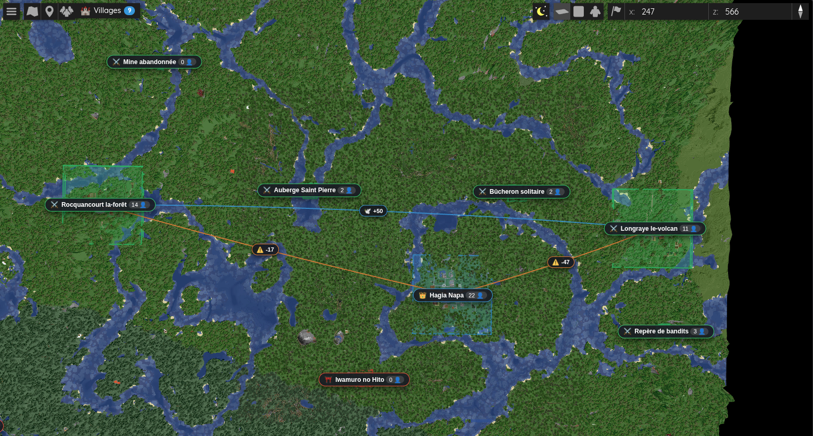
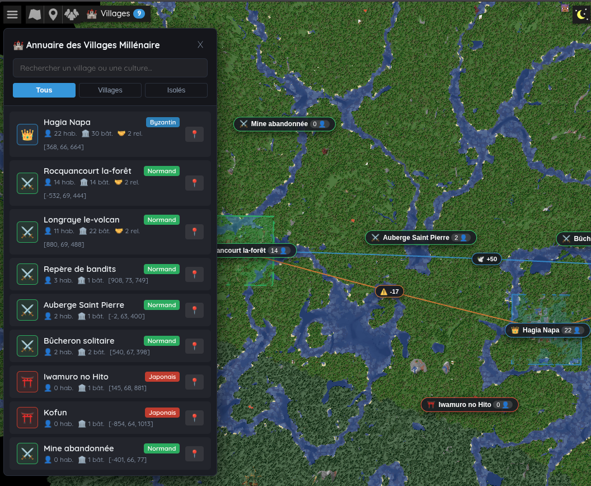
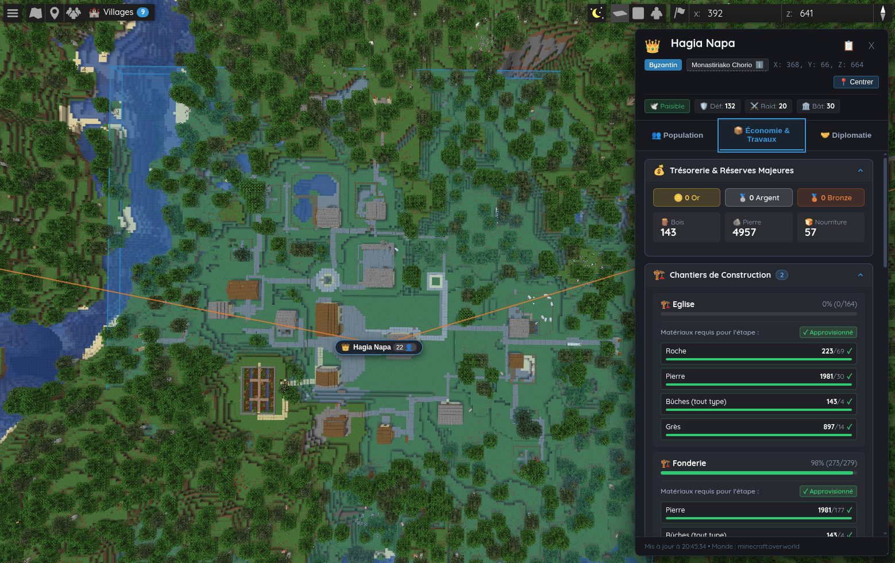

[English](README.md) | [Français](README_FR.md)

# Millénaire BlueMap Bridge

[](https://www.minecraft.net/)
[](https://neoforged.net/)
[](https://millenaire.org/)
[](https://bluemap.bluecolored.de/)
[](https://openjdk.org/)
[](LICENSE)

**Millénaire BlueMap Bridge** seamlessly integrates the living, historical civilisations of **Millénaire 9.1.0+** into **BlueMap's** high-performance 3D web map on **Minecraft 26.3 (NeoForge)**.

By bridging Millénaire's rich simulation engine with BlueMap's WebGL rendering pipeline, this mod brings dynamic territorial polygons, 3D parabolic diplomatic arcs, live village population counts, construction progress trackers, stockpile audits, and authentic historical lore directly into your web browser in real time—with zero server lag.

---

## Table of Contents

- [Core Capabilities](#core-capabilities)
  - [Zero-Lag In-Memory Architecture](#1-zero-lag-in-memory-architecture)
  - [3D BlueMap World Visualization](#2-3d-bluemap-world-visualization)
  - [Interactive Web Interface & Directory Drawer](#3-interactive-web-interface--directory-drawer)
- [Visual Media Showcase](#visual-media-showcase)
- [Technical Specifications & Compatibility](#technical-specifications--compatibility)
- [Step-by-Step Installation Guide](#step-by-step-installation-guide)
  - [Part 1: Mod Installation (Server / Client)](#part-1-mod-installation-server--client)
  - [Part 2: BlueMap Web Frontend Setup](#part-2-bluemap-web-frontend-setup)
- [Repository Structure](#repository-structure)
- [Credits & Attributions](#credits--attributions)
- [License](#license)

---

## Core Capabilities

### 1. Zero-Lag In-Memory Architecture

Millénaire BlueMap Bridge is engineered from the ground up for high-traffic dedicated servers and multiplayer communities:

- **Asynchronous In-Memory Extraction**: The bridge scans village states every 5 seconds (100 server ticks) strictly querying cached memory data (`building.getInventory().getCachedContents()`). Main server thread tick execution time is **below 0.15 ms**, guaranteeing **zero TPS drops** and zero lag spikes.
- **Dedicated Off-Thread Worker**: All JSON data transformations, coordinate projections, and BlueMap marker construction are processed asynchronously off the Minecraft server loop with reentrancy protection.
- **Atomic File Serialization**: Village telemetry is written to `bluemap/web/data/millenaire_details.json` using temporary atomic staging files (`.tmp` write followed by atomic rename), preventing corrupted or partial reads by connected web browsers.
- **Automated BlueMap Region Re-rendering**: When a Millénaire construction project advances, finishes, or expands village borders, the bridge detects modified chunks, coordinates with the chunk source to flush MCA files (`overworld.getChunkSource().save(false)` with a 15-second debounce cooldown), and schedules localized BlueMap region re-renders automatically.

---

### 2. 3D BlueMap World Visualization

The mod injects custom vector marker sets directly into the BlueMap 3D world view:

#### Culture-Themed 3D Territorial Extrusions (`ExtrudeMarker`)
Each village territory is outlined as a semi-transparent 3D volume box extruded vertically, colored with authentic culture palettes:

| Culture | Visual Theme | Hex Code | Border & Fill Styling |
|---|---|---|---|
| **Normans** | Soft Emerald | `#2ecc71` | 3D green extruded territory |
| **Byzantines** | Imperial Sapphire | `#3498db` | 3D azure extruded territory |
| **Japanese** | Soft Crimson | `#e74c3c` | 3D red extruded territory |
| **Mayans** | Soft Amber | `#f1c40f` | 3D gold extruded territory |
| **Indian / Hindi** | Soft Amethyst | `#9b59b6` | 3D purple extruded territory |
| **Inuit** | Soft Turquoise | `#1abc9c` | 3D cyan extruded territory |
| **Seljuks** | Soft Terracotta | `#e67e22` | 3D orange extruded territory |

#### 3D Parabolic Diplomatic Lines (`LineMarker`)
Foreign relations between neighboring settlements are visualized as smooth 3D parabolic arches soaring above the terrain:
- **Allied & Friendly Relations**: Bright emerald arcs with interactive midpoint badges displaying positive relationship standings.
- **War & Hostile Relations**: Vivid crimson arcs with conflict warnings, highlighting active rivalries and potential military clashes.
- **Intelligent Visual Filtering**: Neutral diplomatic ties are intentionally excluded from 3D line generation to prevent map clutter ("spaghetti map syndrome").

#### Floating 2.5D Village Center Badges (`HtmlMarker`)
Positioned at each town center, floating HTML badges display:
- Cultural banner icon and civilization crest
- Official village name and designation
- Real-time resident population count
- Instant camera snap and side-panel focus on click

---

### 3. Interactive Web Interface & Directory Drawer

The included frontend extension (`web/js/millenaire_panel.js` & `web/css/millenaire_panel.css`) seamlessly integrates into BlueMap's UI:

- **Embedded Control Bar Launcher**: A sleek pill button (`🏰 Villages`) sits in the top BlueMap navigation bar with an active village counter badge.
- **Slide-Out Village Directory Drawer**:
  - Live instantaneous text search across village names, cultures, and leaders.
  - One-click filter chips: **All**, **Villages**, and **Lone Buildings**.
  - Quick-travel camera centering to any settlement with smooth altitude transition.
- **Comprehensive 3-Tab Village Detail Panel**:
  - 👥 **Population Tab**: Census breakdown showing adult men, women, and children ratios, active resident lists, and occupations.
  - 📦 **Economy & Projects Tab**: Village treasury balance (deniers, sous), real-time progress bars for ongoing construction projects, missing building material tallies, and detailed stockpile storage gauges.
  - 🤝 **Diplomacy Tab**: Standing relation meters (-100 to +100), distance indicators, peace status, and active raid warnings.
- **Contextual Lore & Building Tooltips**: Official historical lore descriptions and building background information extracted from Millénaire's Travel Book.
- **Modern Accessibility & Performance**: Full keyboard navigation (`Enter` / `Space`), `:focus-visible` outlines, reduced-motion preferences (`prefers-reduced-motion`), and responsive mobile drawer adaptation.

---

## Visual Media Showcase

*Live high-resolution gameplay captures taken directly in the BlueMap WebGL interface:*

### 1. 3D Territorial & Village Overview

*Figure 1: Full-scene 3D overview of village territories and diplomatic arcs within the BlueMap WebGL canvas.*

### 2. Interactive Village Directory Drawer

*Figure 2: Slide-out directory drawer providing instant search and navigation across all world settlements.*

### 3. Real-Time Village Inspection Side Panel

*Figure 3: Rich multi-tab inspection panel displaying live demographic, economic, and diplomatic telemetry.*

---

## Technical Specifications & Compatibility

| Specification | Target / Requirement | Verification & Details |
|---|---|---|
| **Minecraft Version** | `26.3` | NeoForge runtime environment |
| **Mod Loader** | `NeoForge 26.3.0+` | Validated on NeoForge 26.3.0.102 |
| **Java Runtime** | `Java 25+` / `Java 27` | Compiled with OpenJDK 27 targeting `--release 25` |
| **Millénaire Mod** | `9.1.0+` | Tested with `millenaire-9.1.0+mc26.3.jar` |
| **BlueMap Mod** | `5.11+` \| `5.29` | Tested with `bluemap-5.29-neoforge.jar` (API compatible 5.11+) |
| **Environment** | Server & Client | Dedicated server required for data extraction; fully functional in singleplayer |
| **Web Browsers** | Chrome, Firefox, Safari, Edge | Modern browsers supporting WebGL and ES6+ modules |

---

## Step-by-Step Installation Guide

The installation is cleanly split into two distinct steps: (1) installing the mod JAR in your Minecraft instance, and (2) enabling the web frontend assets in your BlueMap configuration.

### Part 1: Mod Installation (Server / Client)

1. Verify that your server or singleplayer client runs **Minecraft 26.3** with **NeoForge 26.3.0+**.
2. Place the required core mods in your instance's `mods/` directory:
   - `millenaire-9.1.0+mc26.3.jar` (or later)
   - `bluemap-5.29-neoforge.jar` (or 5.11+)
3. Download `millenaire-bluemap-bridge-1.0.0.jar` from the [Releases](https://github.com/Q300Z/millenaire-bluemap-bridge/releases) page and copy it into the `mods/` directory.
   - Alternatively, clone and compile from source:
     ```bash
     git clone git@github.com:Q300Z/millenaire-bluemap-bridge.git
     cd millenaire-bluemap-bridge
     ./build.sh
     ```
4. Start your server once to initialize the bridge. The mod will automatically register custom BlueMap marker sets and prepare the telemetry export pipeline.

---

### Part 2: BlueMap Web Frontend Setup

To provide administrators with maximum flexibility and avoid overwriting existing web customization, the bridge delivers modular web assets (`web/js/millenaire_panel.js` and `web/css/millenaire_panel.css`) accompanied by a non-destructive configuration snippet.

#### 1. Copy Frontend Assets
Copy the mod's web files into your BlueMap web deployment folder:
- Copy `web/js/millenaire_panel.js` → `<server_root>/bluemap/web/js/millenaire_panel.js`
- Copy `web/css/millenaire_panel.css` → `<server_root>/bluemap/web/css/millenaire_panel.css`

#### 2. Configure BlueMap (`webapp.conf`)
Open your server's existing BlueMap configuration file located at `<server_root>/config/bluemap/webapp.conf`.

Locate the `scripts` and `styles` arrays, and append the Millénaire panel files:

```hocon
# Add Millénaire BlueMap Bridge scripts and styles to your existing webapp.conf:
scripts: [
    "js/millenaire_panel.js"
]

styles: [
    "css/millenaire_panel.css"
]
```

#### 3. Access Your Map
Open your web browser and navigate to your BlueMap web address (e.g., `http://localhost:8100` or your server's domain). The `🏰 Villages` launcher button will appear in the top control bar!

---

## Repository Structure

```
millenaire-bluemap-bridge/
├── .gitignore                    # NeoForge, Java, and IDE ignore rules
├── LICENSE                       # MIT License
├── README.md                     # Comprehensive English documentation
├── README_FR.md                  # Comprehensive French documentation
├── build.sh                      # Standalone compiler script
├── docs/
│   └── screenshots/              # Official WebGL in-game screenshots
│       ├── city.png              # Detailed village inspection panel
│       ├── city_list.png         # Interactive directory drawer
│       └── overview.png          # 3D territory and diplomatic lines overview
├── libs/
│   └── flow-math-1.0.3.jar       # Vector math dependency
├── src/
│   └── main/
│       ├── java/org/millenaire/bridge/
│       │   ├── MillenaireBridgeMod.java
│       │   ├── BlueMapIntegrationService.java
│       │   ├── VillageDataExtractor.java
│       │   ├── AtomicJsonExporter.java
│       │   ├── VillageZoneMarkerBuilder.java
│       │   ├── DiplomaticLineMarkerBuilder.java
│       │   └── VillageCenterMarkerBuilder.java
│       └── resources/META-INF/neoforge.mods.toml
└── web/
    ├── css/
    │   └── millenaire_panel.css  # Modern UI stylesheet with CSS variables
    └── js/
        └── millenaire_panel.js   # Interactive UI logic & BlueMap hook
```

---

## Credits & Attributions

- **[Millénaire](https://millenaire.org/)**: Created by Kinniken and maintained by the Millénaire community. We pay tribute to their brilliant historical civilizations, architectural designs, rich economic systems, and immersive world lore.
- **[BlueMap](https://bluemap.bluecolored.de/)**: Created by Blue (TBlueF) and community contributors. High-performance, photorealistic 3D web mapping for Minecraft.
- **[NeoForge](https://neoforged.net/)**: The NeoForged team for providing the modern, robust modding ecosystem for Minecraft.
- **Millénaire BlueMap Bridge**: Developed and maintained by **Q300Z**.

---

## License

This project is licensed under the terms of the **MIT License**.  
See the full text in the [LICENSE](LICENSE) file.
