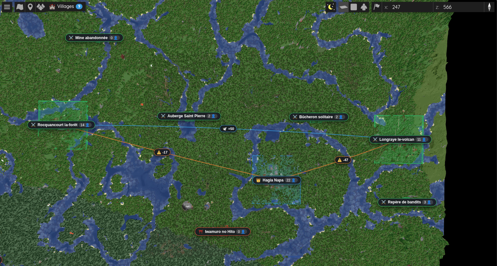
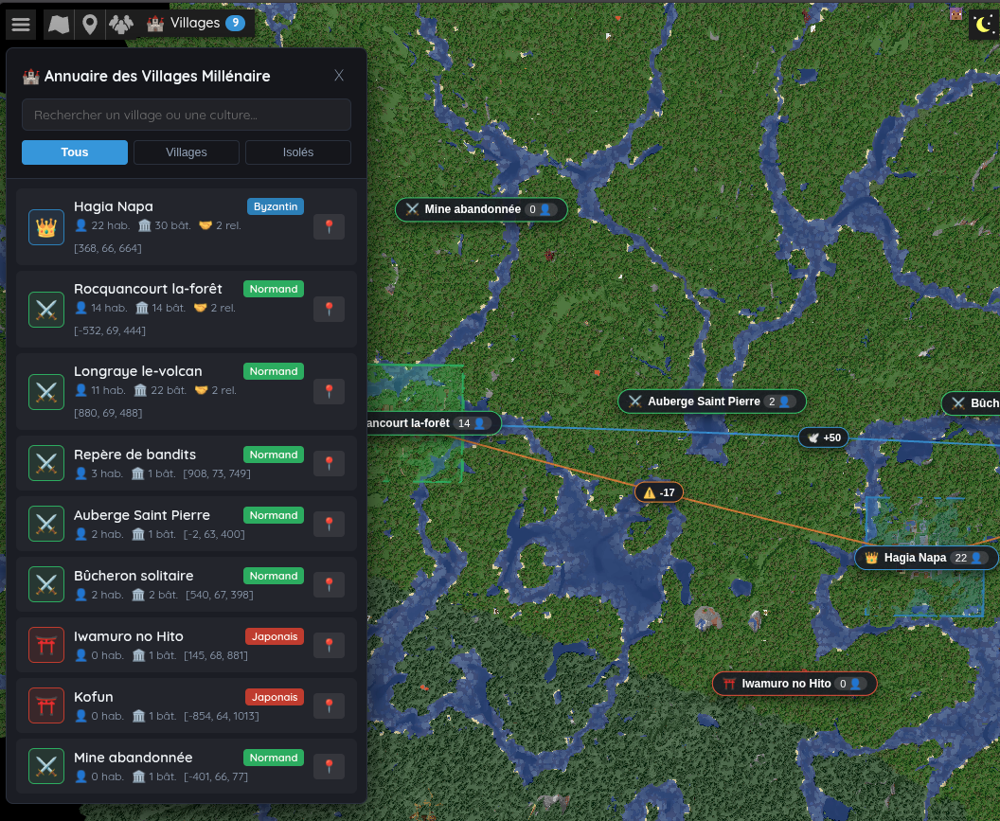
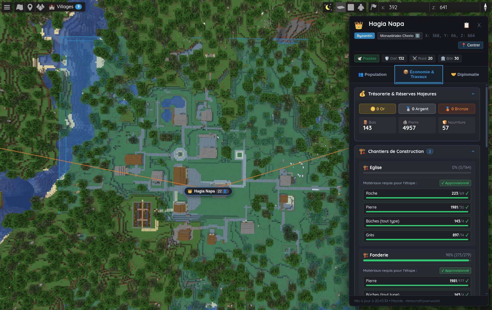

[English](README.md) | [Français](README_FR.md)

# Millénaire BlueMap Bridge

[](https://www.minecraft.net/)
[](https://neoforged.net/)
[](https://millenaire.org/)
[](https://bluemap.bluecolored.de/)
[](https://openjdk.org/)
[](LICENSE)

**Millénaire BlueMap Bridge** assure l'intégration fluide et temps réel de l'univers riche et historique de **Millénaire 9.1.0+** au sein de la cartographie Web 3D haute performance **BlueMap** sous **Minecraft 26.3 (NeoForge)**.

En reliant le moteur de simulation de Millénaire au pipeline de rendu WebGL de BlueMap, ce mod transpose directement dans votre navigateur web les limites territoriales polygonales en 3D, les arches diplomatiques paraboliques, le recensement de population en direct, les jauges de progression des chantiers de construction, l'audit des stocks et le lore historique officiel—le tout sans le moindre ralentissement serveur.

---

## Sommaire

- [Fonctionnalités Clés](#fonctionnalités-clés)
  - [Architecture en Mémoire Sans Ralentissement (Zero-Lag)](#1-architecture-en-mémoire-sans-ralentissement-zero-lag)
  - [Visualisation 3D Temps Réel dans BlueMap](#2-visualisation-3d-temps-réel-dans-bluemap)
  - [Interface Web Interactive & Annuaire Déroulant](#3-interface-web-interactive--annuaire-déroulant)
- [Aperçu Visuel & Galerie d'Images](#aperçu-visuel--galerie-dimages)
- [Spécifications Techniques & Compatibilité](#spécifications-techniques--compatibilité)
- [Guide d'Installation (100% Automatique)](#guide-dinstallation-100-automatique)
  - [Installation en 1 Clic (Recommandé)](#installation-en-1-clic-recommandé)
  - [Exécution Autonome en Ligne de Commande (Optionnel)](#exécution-autonome-en-ligne-de-commande-optionnel)
  - [Installation Manuelle (Avancée)](#installation-manuelle-avancée)
- [Foire Aux Questions & Dépannage (FAQ)](#foire-aux-questions--dépannage-faq)
- [Structure du Dépôt](#structure-du-dépôt)
- [Crédits & Attributions](#crédits--attributions)
- [Licence](#licence)

---

## Fonctionnalités Clés

### 1. Architecture en Mémoire Sans Ralentissement (Zero-Lag)

Millénaire BlueMap Bridge a été conçu spécifiquement pour les serveurs multijoueurs à forte charge et les communautés exigeantes :

- **Extraction Asynchrone en Mémoire Cache** : Le bridge extrait l'état des villages toutes les 5 secondes (100 ticks serveur) en interrogeant exclusivement le cache mémoire de l'inventaire (`building.getInventory().getCachedContents()`). Le temps de calcul sur le thread principal du serveur est **inférieur à 0,15 ms**, garantissant **zéro perte de TPS** et l'absence totale de micro-gels.
- **Thread Asynchrone Dédié** : La transformation des données, la sérialisation JSON et la construction des marqueurs BlueMap sont déportées en tâche de fond asynchrone avec protection stricte contre la réentrance.
- **Sérialisation Atomique sur Disque** : La télémétrie des villages est écrite dans `bluemap/web/data/millenaire_details.json` par le biais d'un fichier temporaire de transit (`.tmp`) suivi d'un renommage atomique, empêchant toute lecture corrompue ou partielle par les navigateurs web connectés.
- **Re-rendu Automatique des Régions BlueMap** : Lorsqu'un chantier progresse, s'achève ou modifie les frontières d'un village, le bridge identifie les tronçons modifiés, déclenche la synchronisation disque des fichiers MCA (`overworld.getChunkSource().save(false)` avec un délai de temporisation de 15 secondes) et programme automatiquement le re-rendu de la zone 3D dans BlueMap.

---

### 2. Visualisation 3D Temps Réel dans BlueMap

Le mod injecte un ensemble de marqueurs vectoriels 3D haute fidélité dans l'univers BlueMap :

#### Zones Territoriales 3D aux Couleurs Culturelles (`ExtrudeMarker`)
Chaque village est matérialisé par un volume 3D polygonal semi-transparent extrudé verticalement depuis le relief, arborant la palette chromatique authentique de sa culture :

| Culture | Thématique Visuelle | Code Hexadécimal | Rendu 3D des Frontières |
|---|---|---|---|
| **Normands** | Émeraude douce | `#2ecc71` | Volume extrudé vert émeraude |
| **Byzantins** | Saphir impérial | `#3498db` | Volume extrudé bleu azur |
| **Japonais** | Pourpre écarlate | `#e74c3c` | Volume extrudé rouge carmin |
| **Mayas** | Ambre solaire | `#f1c40f` | Volume extrudé jaune doré |
| **Indiens / Hindis** | Améthyste | `#9b59b6` | Volume extrudé violet améthyste |
| **Inuits** | Turquoise boréale | `#1abc9c` | Volume extrudé cyan polaire |
| **Seldjoukides** | Terre cuite | `#e67e22` | Volume extrudé orange terre cuite |

#### Arches Diplomatiques Paraboliques 3D (`LineMarker`)
Les relations internationales entre localités voisines s'élèvent au-dessus du relief sous forme d'arches paraboliques 3D fluides :
- **Alliances & Relations Amicales** : Arches vert émeraude éclatantes dotées d'un écusson central affichant le score d'entente diplomatique positive.
- **Guerres & Hostilités** : Arches rouge carmin signalant les conflits armés actifs et les menaces militaires immédiates.
- **Filtrage Visuel Intelligent** : Les relations neutres sont délibérément exclues du tracé 3D afin de préserver la lisibilité de la carte et d'éviter toute saturation visuelle (« effet toile d'araignée »).

#### Badges Flottants 2.5D de Centre de Village (`HtmlMarker`)
Positionnés précisément au cœur de chaque village ou bâtiment isolé, ces marqueurs HTML aériens affichent :
- L'icône culturelle et l'armoirie de la civilisation
- Le nom officiel et le statut du village
- Le décompte des habitants en temps réel
- Un centrage instantané de la caméra et l'ouverture du panneau latéral au clic

---

### 3. Interface Web Interactive & Annuaire Déroulant

L'extension web fournie (`web/js/millenaire_panel.js` et `web/css/millenaire_panel.css`) s'intègre nativement à l'interface BlueMap :

- **Lanceur Intégré à la Barre de Navigation** : Un bouton compact et élégant (`🏰 Villages`) s'insère directement dans la barre d'outils supérieure de BlueMap, orné d'un badge dynamique indiquant le nombre de villages actifs.
- **Tiroir Déroulant de l'Annuaire des Villages** :
  - Recherche textuelle instantanée sur le nom des cités, leurs cultures ou leurs dirigeants.
  - Puces de filtrage rapide en un clic : **Tous**, **Villages** et **Bâtiments Isolés**.
  - Déplacement fluide de la caméra 3D vers le village sélectionné avec ajustement cinématique de l'altitude.
- **Panneau Latéral d'Inspection à 3 Onglets** :
  - 👥 **Onglet Population** : Recensement démographique détaillé ventilant la proportion d'hommes, de femmes et d'enfants, listing des résidents et métiers exercés.
  - 📦 **Onglet Économie & Chantiers** : Trésorerie du village (deniers, sous), barres de progression en pourcentage des chantiers en cours, état des matériaux manquants et jauges des réserves de ressources.
  - 🤝 **Onglet Diplomatie** : Échelle graphique des relations diplomatiques (-100 à +100), distance kilométrique, statut de paix et alertes en cas de raid militaire.
- **Infobulles Contextuelles et Lore Historique** : Descriptions encyclopédiques officielles issues du Livre de Voyage de Millénaire pour chaque type de village et édifice remarquable.
- **Accessibilité & Ergonomie Moderne** : Navigation intégrale au clavier (`Entrée` / `Espace`), surbrillance visuelle `:focus-visible`, respect des préférences d'animation réduite (`prefers-reduced-motion`) et adaptation responsive aux écrans mobiles.

---

## Aperçu Visuel & Galerie d'Images

*Captures d'écran officielles prises directement en jeu dans l'interface WebGL de BlueMap :*

### 1. Vue d'Ensemble 3D du Territoire et du Village

*Figure 1 : Vue d'ensemble 3D des délimitations territoriales et des arches diplomatiques dans le canevas WebGL de BlueMap.*

### 2. Tiroir Déroulant de l'Annuaire Interactif

*Figure 2 : Annuaire déroulant offrant une navigation et une recherche instantanées à travers toutes les colonies du monde.*

### 3. Panneau Latéral d'Inspection Temps Réel

*Figure 3 : Panneau d'inspection multi-onglets présentant la télémétrie démographique, économique et diplomatique en temps réel.*

---

## Spécifications Techniques & Compatibilité

| Caractéristique | Spécification / Prérequis | Détails de Validation |
|---|---|---|
| **Version Minecraft** | `26.3` | Environnement NeoForge |
| **Chargeur de Mod** | `NeoForge 26.3.0+` | Testé et validé sur NeoForge 26.3.0.102 |
| **Runtime Java** | `Java 25+` / `Java 27` | Compilé sous OpenJDK 27 avec l'option `--release 25` |
| **Mod Millénaire** | `9.1.0+` | Validé avec `millenaire-9.1.0+mc26.3.jar` |
| **Mod BlueMap** | `5.11+` \| `5.29` | Validé avec `bluemap-5.29-neoforge.jar` (API compatible 5.11+) |
| **Environnement** | Serveur & Client | Requis côté serveur pour la télémétrie ; compatible partie solo |
| **Navigateurs Web** | Chrome, Firefox, Safari, Edge | Navigateurs modernes supportant WebGL et modules ES6+ |

---

## Guide d'Installation (100% Automatique)

Grâce à son installeur intégré autonome (**Zero-Config Drop-in**), **un seul fichier `.jar` installe et configure absolument tout** sans aucune intervention manuelle de votre part !

### Installation en 1 Clic (Recommandé)

1. Assurez-vous que votre serveur ou client solo dispose de **Minecraft 26.3**, de **NeoForge 26.3.0+**, de **Millénaire 9.1.0+** et de **BlueMap 5.11+ / 5.29**.
2. Téléchargez le fichier `millenaire-bluemap-bridge-1.0.0.jar` depuis la page des [Releases](https://github.com/Q300Z/millenaire-bluemap-bridge/releases) et déposez-le dans le répertoire `mods/` de votre instance.
3. **Lancez simplement Minecraft !**
   - Le mod extrait automatiquement les composants Web (`millenaire_panel.js` et `millenaire_panel.css`) dans le dossier `bluemap/web/`.
   - Le mod configure et décommente automatiquement votre fichier `config/bluemap/webapp.conf`.
4. Ouvrez votre navigateur sur la carte BlueMap (`http://localhost:8100`) et effectuez un rafraîchissement forcé (`Ctrl + F5` ou `Cmd + Shift + R`).  
   **Le bouton `🏰 Villages` est immédiatement fonctionnel !**

---

### Exécution Autonome en Ligne de Commande (Optionnel)

Si vous administrez un serveur headless ou préparez un conteneur Docker et souhaitez pré-installer les fichiers web et la configuration avant même de lancer le serveur Minecraft :

```bash
# Exécution directe en standalone du fichier jar (zéro dépendance externe requise) :
java -jar mods/millenaire-bluemap-bridge-1.0.0.jar
```

---

### Installation Manuelle (Avancée)

Si vous utilisez une infrastructure personnalisée (serveur Web Nginx/Apache externe, reverse proxy statique) :

1. Les fichiers web sources sont disponibles dans le dossier `web/` du dépôt ou dans l'archive `millenaire-bluemap-web-assets-<version>.zip`.
2. Déposez `millenaire_panel.js` dans `<webroot>/js/` et `millenaire_panel.css` dans `<webroot>/css/`.
3. Ajoutez-les dans `config/bluemap/webapp.conf` :
   ```hocon
   scripts: [
       "js/millenaire_panel.js"
   ]
   styles: [
       "css/millenaire_panel.css"
   ]
   ```

---

## Foire Aux Questions & Dépannage (FAQ)

<details>
<summary><b>1. Le bouton « 🏰 Villages » n'apparaît pas sur ma carte BlueMap. Que faire ?</b></summary>
<br>

- Assurez-vous que les lignes `scripts: [...]` et `styles: [...]` dans `config/bluemap/webapp.conf` ne comportent plus de dièse `#` en début de ligne.
- Vérifiez que les fichiers sont bien présents dans `bluemap/web/js/millenaire_panel.js` et `bluemap/web/css/millenaire_panel.css`.
- Effectuez un rafraîchissement forcé dans votre navigateur avec `Ctrl + F5` (ou `Cmd + Shift + R` sous macOS).
- Ouvrez la console développeur de votre navigateur (`F12` > Console) pour vérifier qu'aucune erreur réseau 404 ne bloque le chargement.
</details>

<details>
<summary><b>2. Les zones 3D ou les arches diplomatiques ne s'affichent pas dans le monde.</b></summary>
<br>

- Ouvrez le menu des calques de BlueMap (icône de superposition de couches en haut à gauche ou à droite de l'interface BlueMap).
- Vérifiez que les calques **« Villages Millénaire »**, **« Territoires des Villages »** et **« Relations Diplomatiques »** sont bien cochés.
- Si un village vient d'être généré, patientez quelques secondes : le pont met à jour les données en mémoire toutes les 5 secondes.
</details>

<details>
<summary><b>3. Le mod fonctionne-t-il en solo ou nécessite-t-il un serveur dédié ?</b></summary>
<br>

Le mod fonctionne parfaitement dans les deux configurations :
- **En solo :** BlueMap héberge un serveur web interne local accessible sur `http://localhost:8100`.
- **Sur serveur dédié :** Le mod extrait les données sans aucun impact sur le tick rate (zéro TPS drop) et sert les données aux joueurs connectés à l'adresse de la carte en ligne du serveur.
</details>

---

## Structure du Dépôt

```
millenaire-bluemap-bridge/
├── .gitignore                    # Règles d'exclusion Git pour NeoForge, Java et IDEs
├── LICENSE                       # Licence open-source MIT
├── README.md                     # Documentation exhaustive en langue anglaise
├── README_FR.md                  # Documentation exhaustive en langue française
├── build.sh                      # Script de compilation autonome
├── docs/
│   └── screenshots/              # Captures d'écran officielles en haute définition
│       ├── city.png              # Volet d'inspection détaillé d'un village
│       ├── city_list.png         # Tiroir déroulant de l'annuaire interactif
│       └── overview.png          # Vue d'ensemble 3D et liaisons diplomatiques
├── libs/
│   └── flow-math-1.0.3.jar       # Bibliothèque de calcul vectoriel
├── src/
│   └── main/
│       ├── java/org/millenaire/bridge/
│       │   ├── MillenaireBridgeMod.java
│       │   ├── BlueMapIntegrationService.java
│       │   ├── VillageDataExtractor.java
│       │   ├── AtomicJsonExporter.java
│       │   ├── VillageZoneMarkerBuilder.java
│       │   ├── DiplomaticLineMarkerBuilder.java
│       │   └── VillageCenterMarkerBuilder.java
│       └── resources/META-INF/neoforge.mods.toml
└── web/
    ├── css/
    │   └── millenaire_panel.css  # Feuille de styles moderne avec variables CSS
    └── js/
        └── millenaire_panel.js   # Logique interactive et intégration à BlueMap
```

---

## Crédits & Attributions

- **[Millénaire](https://millenaire.org/)** : Conçu par Kinniken et maintenu par la communauté Millénaire. Hommage à leurs splendides civilisations historiques, architectures authentiques, systèmes économiques vivants et lore immersif.
- **[BlueMap](https://bluemap.bluecolored.de/)** : Conçu par Blue (TBlueF) et les contributeurs de la communauté. Cartographie Web 3D photoréaliste et haute performance pour Minecraft.
- **[NeoForge](https://neoforged.net/)** : L'équipe NeoForged pour la plateforme moderne et robuste de modding Minecraft.
- **Millénaire BlueMap Bridge** : Développé et maintenu par **Q300Z**.

---

## Licence

Ce projet est distribué sous les termes de la **Licence MIT**.  
Consultez le texte intégral dans le fichier [LICENSE](LICENSE).
